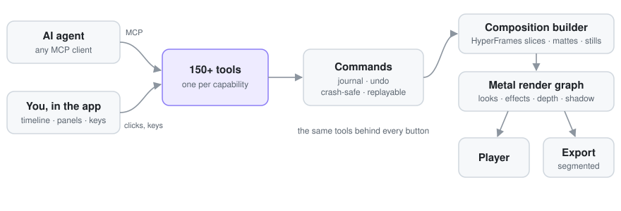

<div align="center">

# Danial MCP Editor

**A native macOS video editor that AI agents drive through MCP, and people drive with a timeline.**


</div>

Every capability is an MCP tool before it is a button. An agent can take a raw
recording to a finished, colour-graded, motion-designed Reel without a window
open; the owner can open the same project in the app, scrub, cut and tweak by
hand, and every click runs the very tool the agent would call. One journal,
one undo history, one render engine for both.

It is built for one production workflow: talking-head Reels, course lessons
and long YouTube videos. Features that workflow does not use are left out on
purpose.

## What it does

| Area | What it gives you |
|---|---|
| **Cut** | Timeline with CapCut's keys, snapping, ripple on the main track, speed with pitch kept, join fades, automatic pause removal from rules, loudness to a target |
| **Grade** | The Edits Adjust panel (Adjust, White Balance, HSL, Style), picked colours, looks shared by clips or tracks, saved profiles, live preview while a slider moves, colour statistics and reference matching for agents |
| **Animate** | Effect plug-ins that are just a folder (manifest + Metal shader), transform keyframes for zooms, freeze frames, still pictures with transparency |
| **Motion graphics** | HyperFrames (HTML and GSAP) compositions as timeline layers, rendered in slices so a fix re-renders only its part |
| **Depth** | A person matte (Apple Vision, or imported SAM masks) puts motion elements *behind* the speaker, with a lit outline and a soft shadow on the wall |
| **Accent colour** | A native picker for the motion-graphics accent: solid, gradient or three colours, eyedropper on the video frame, kit preview, WCAG contrast, CSS out |
| **Sound** | Voice, music and sound-effect tracks, extract audio for J and L cuts, voice-over recording, transcripts that stay on the right words through every cut |
| **Reference downloads** | A post from YouTube, Pinterest, Instagram or X by its link, in the app or through MCP: download, contact sheet, captions and loudness for an agent studying a style, then into the Trash |
| **Images** | A built-in browser agents drive to generate pictures (Google AI Studio, Nano Banana Pro at 4K, every aspect ratio, retries on its own); results land in the media pool |
| **Export** | Segmented, resumable, cached: an interrupted export keeps its finished work, a small edit re-renders only its segments. HEVC 10-bit HLG, H.264, ProRes |

## How it fits together

<p align="center"></p>

- **`EditorCore`**: the data model, time maths and commands. Pure Swift, deterministic: replaying the journal gives the identical project.
- **`EditorKit`**: command bus, journal, undo, settings, the tool catalog.
- **`MediaEngine`**: AVFoundation and Metal: composition, rendering, export, mattes, HyperFrames, the browser.
- **`MCPServer`**: JSON-RPC over HTTP and stdio, written in-house.
- **`dme`**: the editor without a window. **`EditorApp`**: the window.

## Measured

From 4K 60 fps test footage:

| Job | Result |
|---|---|
| 60 s Reel, 30 cuts, look, zoom, picture overlay, SFX → 1440×2560 60 fps HEVC HLG | **35.6 s** (1.7× real time), 262 MB peak memory |
| 4K 60 fps HEVC export | 1.3× real time |
| 1080p 30 H.264 lesson export | 5.3× real time |
| 2,000-clip timeline built in one batch over HTTP | 218 ms |
| Hard kill mid-edit | nothing lost (journal replay) |
| 4K frame with a Gaussian blur | 8.3 ms |
| Automated tests | 148 unit and render tests, 92 UI checks on the live window |

## Keys

CapCut's, from a keymap file you can change (`keymap.set`):

| Key | Action | Key | Action |
|---|---|---|---|
| Space | Play / pause | ⌘B | Split selected clips' tracks at the playhead |
| Q / W | Delete to the clip's start / end | ⌫ | Delete the selection |
| ← → | One frame (⇧ ten) | ↑ ↓ | Previous / next cut |
| Home / End | Start / end of the timeline | M | Marker |
| ⌘C / ⌘V | Copy / paste at the playhead | ⌘D | Duplicate |
| ⌘A / Esc | Select all / none | , / . | Nudge one frame |
| ⌘= / ⌘- / ⇧Z | Zoom in / out / fit | R | Record voice-over |
| ⇞ / ⇟ / ↩ | Start or end of the clip | ⌘Z / ⇧⌘Z | Undo / redo |
| ⌘/ | All shortcuts (Help menu) | ⌥-drag on ruler | Mark a range; ⌫ deletes it |

## Quick start

Needs an Apple Silicon Mac with macOS 26 or later and the Command Line Tools
(Xcode is optional).

```bash
scripts/build-app.sh
```

```bash
open "build/Danial MCP Editor.app"
```

The MCP server runs inside the app. For agents without a window:

```bash
scripts/swift.sh build -c release --product dme
```

```bash
.build/release/dme info
```

`dme info` prints how to connect an MCP client. Agents start with
[`agent_onboard`](docs/agent-guide.md); the full guide is
[docs/agent-guide.md](docs/agent-guide.md).

### Keeping macOS permissions across rebuilds

An ad-hoc signed app looks new to macOS after every build, so privacy grants
(Full Disk Access, the microphone) are lost. Create a code-signing certificate
once in Keychain Access (Certificate Assistant › Create a Certificate, type
*Code Signing*, name `DME Local Signing`) and `build-app.sh` signs with it.

## Development

```bash
scripts/swift.sh build
```

```bash
scripts/swift.sh test
```

Contributors and coding agents start with [AGENTS.md](AGENTS.md). The design
lives in the documents and changes with the code:

- [Requirements](docs/requirements.md): what the editor must do
- [Architecture](docs/architecture.md): how it is built
- [MCP tools](docs/mcp-tools.md): every tool
- [Roadmap](docs/roadmap.md): phases, exit checks and what is open
- [Phase 0](docs/phase0.md): the measurements behind the design

## License

[MIT](LICENSE)
